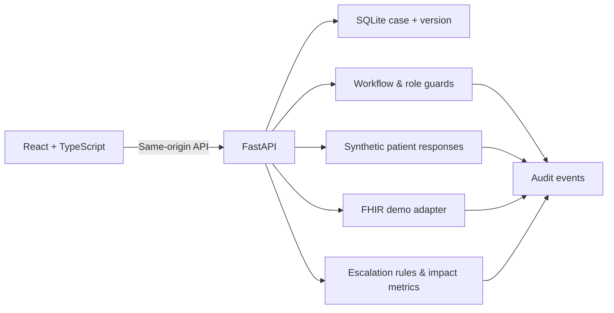

# CareLoop AI 2.0

**From screening to support, handoff and documented follow-up — no patient falls through the cracks.**

CareLoop is an **experimental, synthetic-data care-recovery prototype** for the [Future Health Digital Innovation Challenge 2026](https://hack2skill.com/event/futurehealthchallenge/), track: **Population Health — Closing the Screening-to-Care Loop**. It is not a medical device, healthcare provider, EHR integration or production-ready patient system. The present build does not transmit messages, book real appointments, make medical diagnoses or independently verify completed care.

## What is new in v2

| Capability | Working in this prototype | Limitation |
| --- | --- | --- |
| Care-recovery plans | Staff choose bounded nonclinical interventions for transportation, language, scheduling, cost; separate recorded confirmation required to resolve | Confirmation is staff-attested, not externally verified |
| Patient companion | English/Arabic fictional patient interface; opt-in simulated response, barrier, callback, and appointment acknowledgment | Controlled by demo staff role, not an independently authenticated patient portal; no outbound delivery |
| Cross-provider handoff | Referral sent/accepted/rejected, receiving provider tracking, time-limited nudge logging | Staff simulation only; no provider network connection |
| Escalation command center | Rule-derived backlog, preview, idempotent manual escalation run, case audit entries | No background scheduler and no notification delivery |
| Synthetic FHIR sandbox | Limited FHIR R4 bundle import, ID deduplication, changed/amended/cancelled report review, illustrative FHIR export | Not certified mapping; no live EHR integration; clinical follow-up must be set by demo clinician |
| Impact metrics | Descriptive closure, follow-up, intervention funnel and self-reported language breakdown | Synthetic dataset; cannot establish health impact or fairness |
| Repeatable demo | One guarded clinician-only reset of all 30 demo journeys | Deletes local fictional demo edits |
| Care team workspace | React dashboard, worklist, case pages, 30 fictional journeys, optional limited copilot, role checks and SQLite | Demo role picker is **not** real user authentication |

## Run the full app

Prerequisites: Python 3.11+ and Node.js 22+ with internet access for initial dependency installation. On macOS, Linux or WSL from this directory:

```bash
make setup
make test
make demo
```

Then open **http://127.0.0.1:8000**. `make demo` compiles the frontend and serves it from FastAPI. The first launch automatically seeds 30 fictional cases. SQLite persists edits in `backend/careloop.sqlite3`; delete this file only if you intentionally wish to reset the local demo. Alternatively use the clinician-only **Reset fictional demo** button on the Escalation Center page.

**Windows 11 PowerShell:** Extract the ZIP, open PowerShell inside the `CareLoop-AI-2.0` folder, then run `powershell -ExecutionPolicy Bypass -File .\run-windows.ps1`. This installs dependencies, builds the UI, runs backend tests, and starts the app. Inspect the script before running it. Python and Node.js must already be on PATH.

**Separate development servers:** `make api` (port 8000) and `make web` (Vite dev URL). **Docker:** `docker compose up --build` then open localhost:8000. The supplied Docker configuration binds only to 127.0.0.1.

**Troubleshooting:** If a full frontend build cannot run due to unavailable NPM dependencies, install dependencies with `cd frontend && npm install` on an internet-connected machine, then run `npm run build`. The backend tests do not require Node.js. If installing dependencies on Windows, use a suitable Python virtual environment and run the equivalent commands from the Makefile.

## The demo, from start to finish

1. Switch to **Coordinator** using the role menu. Open **CL-2401** (fictional Elena Martinez), see her unresolved transportation barrier and late referral. Start the care recovery plan, then record a fictional patient or provider confirmation of the intervention. The gap disappears and the audit log updates.
2. Use the **Patient Companion** to simulate a fictional patient acknowledging a newly notified result, reporting an interpreter barrier, or requesting a callback. Switch language between English and Arabic. Responses are stored in the case, not sent over SMS/email.
3. Open **Escalation center**. Preview the queue, then record simulated escalations. Repeating the run immediately should yield **zero new duplicate escalations**. Check each case's event trail.
4. Switch to **Clinician**. In **FHIR sandbox**, import the provided `examples/fhir-synthetic-bundle.json`. Reimport unchanged JSON to see deduplication. Change the DiagnosticReport `status` to `amended` and `issued` timestamp, then reimport to see a clinician-review alert; open the case and record a review.
5. Open **Impact metrics** for counts derived from the current SQLite cases and the intervention funnel. The labels make clear that closed cases are staff-attested synthetic outcomes and **not** externally verified treatment.
6. For final closure: open an evidence-ready seeded case such as **CL-2408** in clinician role, review evidence and close it with a verification note. Compare metrics before and after.
7. Use the guarded reset on Escalation center to restore all 30 fictional cases before recording a clean demo.

## Key technical design



Case writes use optimistic version checks with HTTP 409 on conflicting updates. Patient responses and escalations append events to the case audit. FHIR imports are restricted to clearly tagged fictional identifiers and require a clinician-supplied urgency, follow-up and owner. Each changed report requires review. The default copilot is rule-based; optional model classification does not authorize clinical decisions or case writes.

## API endpoints

| Method | Path | Purpose |
| --- | --- | --- |
| GET/POST | `/api/session` | Choose a fictional role |
| GET/POST | `/api/cases` | Worklist / clinician intake |
| GET | `/api/cases/{id}` | Case and computed gaps |
| POST | `/api/cases/{id}/actions` | Audited, authorized workflow transitions |
| POST | `/api/cases/{id}/copilot` | Grounded coordination assistance |
| POST | `/api/cases/{id}/patient-reply` | Record a synthetic patient response |
| GET | `/api/escalations` | Preview policy-based escalation candidates |
| POST | `/api/escalations/run` | Preview or record in-app policy escalations |
| POST | `/api/fhir/import` | Clinician-approved synthetic bundle import |
| GET | `/api/cases/{id}/fhir/export` | Illustrative FHIR Task/ServiceRequest/Appointment bundle |
| GET | `/api/impact` | Transparent operational metrics |
| POST | `/api/demo/reset` | Clinician-only reset of fictional cases |

## Verification

```bash
python -m unittest discover -s tests -v
```

Ten distinct backend integration tests cover the prior core workflow plus new patient replies, consent/permissions, idempotent escalations, handoffs, synthetic FHIR deduplication/cancellations, clinician review, impact labels and guarded reset. CI configuration is included in `.github/workflows/ci.yml` and builds the frontend with dependencies on GitHub Actions. **Review the test results on your own environment before submission**; backend tests are not a substitute for interactive browser checks.

## Submission package

- [Demo story and spoken script](docs/DEMO_SCRIPT.md)
- [Architecture, security boundaries, FHIR mapping](docs/ARCHITECTURE_AND_SAFETY.md)
- [Clinical pilot and evaluation design](docs/PILOT_AND_EVALUATION.md)
- [Submission checklist and judge evidence](docs/SUBMISSION_CHECKLIST.md)
- [Feature acceptance tests and known gaps](docs/FEATURE_ACCEPTANCE.md)
- [Official challenge 2026](https://hack2skill.com/event/futurehealthchallenge/)

**Use synthetic data only.** Do not put patient information, hospital credentials or API secrets into this prototype. Before genuine healthcare deployment, a licensed clinical partner must define pathways and governance, and the platform requires real identity/access security, independent evidence validation, approved messaging and EHR integrations, privacy impact assessment, resilience, monitoring and clinical validation.

### Brand assets

`assets/CareLoop-AI-logo.png` includes the project's previously created logo for optional use in a pitch deck or video. The brand image is original to this project and does not incorporate sponsor branding.
