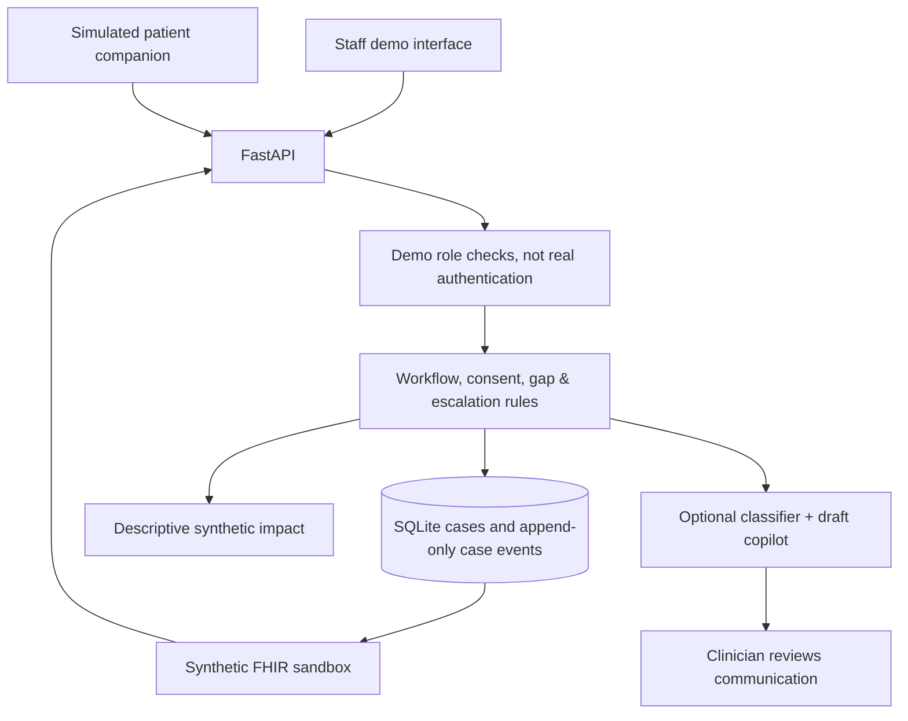

# Architecture, interoperability and responsible-AI assessment

## Components and boundaries

- **Frontend:** React 19, TypeScript, Vite, React Router. Existing Overview, Worklist, Care gaps, Case view, Analytics; new Patient companion, Escalation center, FHIR sandbox and Impact metrics.
- **Backend:** FastAPI and Pydantic validate intake and simulated actions. Workflow authorizes clinician-only decisions, checks stages, and appends an auditable event.
- **Persistence:** SQLite case JSON rows, version column, conflict check on update. This suits a local hackathon demo, not large-scale operations.
- **Coordination logic:** bounded barrier intervention options; status transitions from reported → support started → staff-attested resolved. Reporting never equates a reminder to care completion.
- **Patient channel:** simulated via same staff demo role/session; consent checkbox and preferred language/channel are persisted. No SMS, emails, push messages or authenticated patient login.
- **Escalation:** on-demand rule engine identifies cases needing review and writes in-app events exactly once per currently open gap. Not a scheduler or reliable outbound task queue.
- **FHIR:** limited importer/exporter for strictly fictional resources. Import is *not* automated clinical interpretation. It requires manually authored clinician follow-up, deadline and urgency; updates flag review.
- **AI:** optional bounded model classifier for administrative intents. No autonomous clinician decision-making or automatically delivered text. All drafted messages require review.

## Interoperability design and restrictions

Only a bundle containing one `Patient` and one `DiagnosticReport` is supported. `Patient.id` and `DiagnosticReport.id` must begin with `demo-`, the report must reference the given synthetic patient, and the patient name must begin with **Demo** or **Synthetic**. The caller must send `confirm_synthetic: "SYNTHETIC-DEMO"` and supply clinician-approved follow-up details. **Prefix checks are not proof data are deidentified; never import genuine patient data.**

- `DiagnosticReport.id` maps to a stable case ID via SHA-256 prefix for deduplication.
- A canonical report-content hash distinguishes exact duplicates from changed results.
- `final` reports create cases with clinician-directed follow-up. `amended`, `corrected`, `cancelled`, and `entered-in-error` reports raise clinician-review flags.
- Later changes preserve the original care plan and audit the incoming update. A changed report on a previously closed case is flagged for reopening and review.
- Export provides **illustrative FHIR-shaped** `Task`, `ServiceRequest`, and when applicable `Appointment`; there is no validator-certified FHIR profile, live EHR transaction or receiver acceptance.
- Production implementation would require identity matching, terminology standards, versioning, provenance, profile validation, consent and security review, retry/idempotency for EHR transactions, and certified integration testing.

## Threat model and residual risks

| Risk | Demo control | Still required for production |
| --- | --- | --- |
| Unauthorized edits | Demo role checks; viewer cannot modify, clinician-only priority/closure/import | SSO/OIDC, MFA, real accounts, tenant and patient-level RBAC |
| Conflicting edits | Optimistic version checking and HTTP 409 | Server-side transaction/isolation design for managed database |
| Wrong clinical advice | No model-driven clinical urgency; clinician assigns plans | Clinically approved protocols, safety reviews and decision-support regulation assessment |
| Unsafe report changes | FHIR changes flag clinician review; don't replace clinical plan | External provenance, transaction logs, strict FHIR profile validation |
| False completion claims | Staff-attested completion distinguished in UI | Independently verified EHR reports, qualified clinical signatures and reconciliation |
| Patient confidentiality | Fictional data only; basic no-store and anti-embedding HTTP headers | Encryption in transit/at rest, HIPAA/PIPEDA/UAE compliance review as applicable, retention, deletion, privacy impact assessment |
| Outbound abuse | No message delivery or real referral network integration | Consent-based messaging, template signoff, rate limits, delivery tracking |
| Operations outage | Manual escalation simulation and local SQLite | Queue/scheduler with retry/dead-letter, uptime monitoring, failover and disaster recovery |

**Critical caveat:** The session picker creates impersonable local demo roles and sessions in server memory. The prototype is **not** authenticated healthcare software, and cannot safely store real PHI even if deployed behind HTTPS without further work. The HTTP headers are defense-in-depth only.

## Clinical safety and usability

- Simulation does not interpret medical values or specify therapeutic recommendations.
- An appointment acknowledgment does not equate to attendance or verified care.
- Closure is gated on recorded evidence, clinician role, resolved barriers and reviewed drafts; references are staff-entered, not externally validated.
- Arabic static interface text is a demonstration and needs professional linguistic/clinical validation before patient use.
- Empty or invalid results, unauthorized actions and edited version conflicts should fail safely with visible errors.
- Human escalation and emergency instructions must be designed with clinical partners before any real-world pilot.
